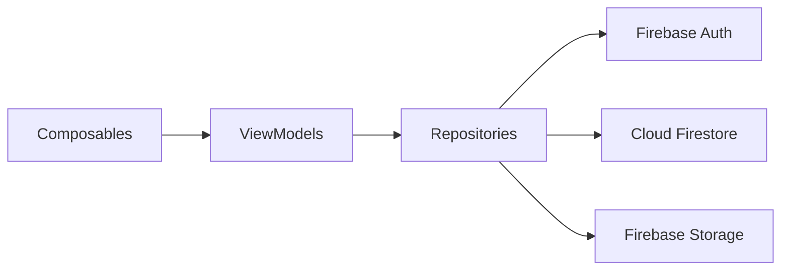

<p align="center">
  
</p>

<p align="center">
  
  
  
  
</p>

<p align="center">
  
  
  
</p>

---

## 📱 ¿Qué es?

Una red social para Android inspirada en Facebook, hecha como proyecto de la materia **Tecnologías Móviles** en la UNAB. Permite registrarse, publicar, reaccionar, comentar y agregar amigos, todo con una interfaz moderna construida 100% en Jetpack Compose.

> ⚠️ Proyecto académico sin fines comerciales. No está afiliado ni respaldado por Meta.

## ✨ Funcionalidades

| | Funcionalidad | Descripción |
|---|---|---|
| 🔐 | **Autenticación** | Registro e inicio de sesión con correo y contraseña |
| 📰 | **Feed** | Publicaciones de tus amigos en tiempo real |
| 📝 | **Publicaciones** | Crear posts con texto e imágenes |
| 👍 | **Reacciones** | Me gusta y reacciones en cada publicación |
| 💬 | **Comentarios** | Comentar y responder en los posts |
| 👤 | **Perfil** | Foto, portada, biografía y tus publicaciones |
| 🤝 | **Amigos** | Enviar, aceptar y rechazar solicitudes |
| 🔔 | **Notificaciones** | Aviso cuando alguien reacciona, comenta o te agrega |

## 🛠️ Tecnologías

- **Lenguaje:** Kotlin
- **UI:** Jetpack Compose + Material 3
- **Arquitectura:** MVVM
- **Navegación:** Navigation Compose
- **Backend:** Firebase Authentication, Cloud Firestore y Firebase Storage
- **Imágenes:** Coil
- **Asincronía:** Kotlin Coroutines + Flow

## 🏗️ Arquitectura

```
app/
└── src/main/java/com/proyecto/socialapp/
    ├── data/
    │   ├── model/          # User, Post, Comment, FriendRequest
    │   └── repository/     # Acceso a Firebase
    ├── ui/
    │   ├── auth/           # Login y registro
    │   ├── feed/           # Feed principal
    │   ├── post/           # Crear y ver publicaciones
    │   ├── profile/        # Perfil de usuario
    │   ├── friends/        # Solicitudes y lista de amigos
    │   ├── components/     # Composables reutilizables
    │   └── theme/          # Colores, tipografía, formas
    ├── navigation/         # NavHost y rutas
    └── MainActivity.kt
```



## 🚀 Cómo correrlo

**Requisitos:** Android Studio (versión reciente), JDK 17 y un proyecto de Firebase.

1. Clona el repo:
   ```bash
   git clone https://github.com/RareChimera87/facebook.git
   ```
2. Crea un proyecto en la [consola de Firebase](https://console.firebase.google.com/), registra la app Android y descarga `google-services.json`.
3. Copia `google-services.json` dentro de la carpeta `app/`.
4. En Firebase, activa **Authentication (correo/contraseña)**, **Firestore** y **Storage**.
5. Abre el proyecto en Android Studio, sincroniza Gradle y dale ▶️ Run.

## 👨‍💻 Autor

<p align="center">
  
</p>

<h3 align="center">Santiago Reina</h3>

<p align="center">
  Estudiante de Ingeniería de Sistemas en la UNAB · Bucaramanga, Colombia<br/>
  Backend con Python y FastAPI, apasionado por la seguridad en IA.
</p>

<p align="center">
  <a href="https://github.com/RareChimera87"></a>
  <a href="mailto:sanctireinadiaz@gmail.com"></a>
</p>

## 🎓 Contexto académico

Proyecto de aula de **Tecnologías Móviles**, Ingeniería de Sistemas, Universidad Autónoma de Bucaramanga (UNAB).

<p align="center">
  
</p>
